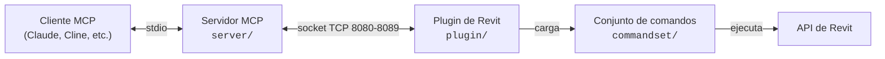

[](https://github.com/desarrollospaloblanco/mcp-revit)

# mcp-revit · Desarrollos Palo Blanco

**Conecta asistentes de IA con Autodesk Revit por medio del Model Context Protocol (MCP).**

mcp-revit permite que clientes como Claude lean, creen, modifiquen y borren elementos en proyectos de Revit.
Tiene tres piezas: un servidor MCP en TypeScript que expone las herramientas a la IA, un add-in de Revit en C#
que recibe los comandos dentro de Revit, y un conjunto de comandos en C# que hace el trabajo con la API de Revit.

Este repositorio es el fork de **Desarrollos Palo Blanco (DPB)**. Lo trabaja Javier Borrayo desde el 31 de agosto
de 2026, y lo que hoy hace salió del trabajo diario en proyectos reales: torres, casas, cuantificación de concreto
y acero, planos de áreas y presentaciones.

## Origen y colaboración

El código viene de una cadena de proyectos de código abierto con licencia MIT:

1. [revit-mcp](https://github.com/mcp-servers-for-revit/revit-mcp), el proyecto original.
2. [mcp-servers-for-revit](https://github.com/mcp-servers-for-revit/mcp-servers-for-revit), que unió servidor, plugin y comandos en un solo repositorio.
3. Este fork, tomado como copia del contenido y no como clon de git, así que la historia del upstream no está aquí.
   Esta sección es el registro de dónde vino el código. Los avisos de copyright del upstream se conservan intactos en [LICENSE](./LICENSE).

### Antes y después del fork

| | Proyecto original (agosto 2026) | Con el trabajo de DPB (noviembre 2026) |
| --- | --- | --- |
| Herramientas MCP | 26 | 89 (63 nuevas) |
| Commits propios | | 85, de Javier Borrayo |
| Documento de trabajo | Siempre el activo | Cualquier documento abierto por título |
| Diálogos de Revit | Una advertencia al guardar dejaba Revit esperando un clic | Advertencias borradas y errores resueltos o revertidos, con reporte en el resultado |
| Scripts en C# | Una transacción en el documento activo | Un solo deshacer por ejecución en todos los documentos, prueba en seco, política de aprobación e historial de 14 días |
| Sesiones de Revit | Una, en el puerto 8080 | Hasta diez, puertos 8080 a 8089, con registro de instancias |
| Unidades | Pies o milímetros según la herramienta | Metros en todas las herramientas nuevas |
| Distribución | Paquete npm y zips del upstream | Release propio con add-in para Revit 2023 a 2026, servidor, scripts y skills |
| Flujos completos | Ninguno | Modelo desde PDF, cuantificación de concreto, acero en quintales, planos de áreas y presentación |

### Qué traía el proyecto original

Un servidor MCP con 26 herramientas generales, un plugin con su ventana de configuración, el conjunto de comandos,
pruebas de integración con Nice3point.TUnit.Revit y un flujo de publicación a npm. Las herramientas trabajaban sobre
la vista y el documento activos.

| Herramienta | Qué hace |
| --- | --- |
| `get_current_view_info` | Información de la vista activa |
| `get_current_view_elements` | Elementos de la vista activa |
| `get_available_family_types` | Tipos de familia cargados en el proyecto |
| `get_selected_elements` | Elementos seleccionados |
| `get_material_quantities` | Cantidades de materiales |
| `ai_element_filter` | Consulta de elementos pensada para asistentes de IA |
| `analyze_model_statistics` | Conteos y complejidad del modelo |
| `create_point_based_element` | Elementos por punto: puerta, ventana, mobiliario |
| `create_line_based_element` | Elementos por línea: muro, viga, tubería |
| `create_surface_based_element` | Elementos por superficie: piso, cielo, techo |
| `create_grid` | Sistema de ejes con espaciado automático |
| `create_level` | Niveles en cotas dadas, en milímetros |
| `create_room` | Crear y colocar habitaciones |
| `create_dimensions` | Cotas en la vista activa |
| `create_structural_framing_system` | Sistema de vigas estructurales |
| `delete_element` | Borrar elementos por id |
| `operate_element` | Seleccionar, colorear, ocultar o aislar elementos |
| `color_elements` | Colorear por valor de un parámetro en la vista activa |
| `tag_all_walls` | Etiquetar todos los muros de la vista activa |
| `tag_all_rooms` | Etiquetar todas las habitaciones de la vista activa |
| `export_room_data` | Exportar los datos de las habitaciones |
| `store_project_data` | Guardar datos del proyecto en una base local |
| `store_room_data` | Guardar datos de habitaciones en una base local |
| `query_stored_data` | Consultar los datos guardados |
| `send_code_to_revit` | Ejecutar C# dentro de Revit (ampliada por DPB, ver más abajo) |
| `say_hello` | Diálogo de saludo para probar la conexión |

### Qué agregamos

Cada herramienta nueva reemplazó trabajo que se hacía a mano o con scripts enviados por `send_code_to_revit`.
Cuando algo se repetía o costaba varios intentos, se convirtió en comando del add-in.

#### Parámetros y tablas (septiembre 2026)

| Herramienta | Qué hace |
| --- | --- |
| `get_parameter` | Leer un parámetro, o todos, de un elemento |
| `modify_element` | Escribir varios parámetros de un elemento en una sola transacción |
| `set_parameter` | Escribir un parámetro en muchos elementos |
| `normalize_parameter_text` | Unificar mayúsculas o minúsculas de un parámetro en tipos, instancias y materiales |
| `duplicate_schedules_with_parameter` | Duplicar tablas para otro valor de un parámetro y ajustar su filtro |
| `set_schedule_parameter_filter` | Agregar o cambiar el filtro por parámetro de varias tablas sin tocar sus columnas |

#### Cuantificación (septiembre 2026)

| Herramienta | Qué hace |
| --- | --- |
| `create_foundation_earthworks` | Masas de excavación y relleno de cimientos como Toposolids (Revit 2024+) |
| `assign_bim_level` | Escribir el nivel con el que se cuantifica cada losa y viga |
| `classify_elements` | Asignar Assembly Code por regla y derivar el Type Mark que falta |
| `analyze_clashes` | Encontrar estructura que se traslapa sin estar unida, y colorearla |
| `copy_ramps_as_floors` | Copiar rampas como pisos inclinados para que entren en la cuantificación de losas |
| `create_grid_railings` | Trazar los ejes con barandas para medir el trazo |
| `format_schedules` | Renombrar encabezados de tablas y darles un formato único |

#### Modelo desde datos (septiembre 2026)

| Herramienta | Qué hace |
| --- | --- |
| `build_model_from_spec` | Niveles, ejes, columnas, muros, puertas, ventanas, vigas y losas desde una especificación en metros |
| `export_view_image` | Exportar una planta, una vista o el 3D a PNG para revisar |

#### Control de ejecución y ayudas para el agente (octubre 2026)

| Herramienta | Qué hace |
| --- | --- |
| `set_execution_policy` | Aplicar los cambios, pedir aprobación en Revit o no guardar nada (auto, ask, readonly) |
| `get_run_history` | Lista de las ejecuciones de `send_code_to_revit` guardadas |
| `get_run` | Una ejecución guardada: código, resultado y cambios |
| `lookup_revit_api` | Firmas, enums y métodos de creación leídos del Revit abierto |
| `capture_view` | PNG de una vista, o de un 3D temporal enmarcado en elementos |
| `mep_review` | Revisión MEP de solo lectura |
| `list_revit_instances` | Sesiones de Revit escuchando en los puertos 8080 a 8089 |
| `select_revit_instance` | Elegir la sesión de Revit con la que se trabaja |
| `set_dialog_guard` | Encender o apagar la guardia que contesta diálogos modales de Revit |
| `get_dialog_log` | Registro de los diálogos que contestó la guardia |

#### Trabajo recurrente, primera ronda (octubre 2026)

| Herramienta | Qué hace |
| --- | --- |
| `set_perspective_view` | Perspectiva de presentación con la misma cámara y recorte en varios modelos |
| `copy_view_camera` | Copiar la cámara y el recorte de un 3D a otros modelos |
| `export_views` | Exportar muchas vistas de varios modelos a PNG |
| `save_documents` | Guardar, y sincronizar con central si se pide, fuera de toda transacción |
| `check_hosted_openings` | Revisar puertas y ventanas contra el muro que las aloja |
| `create_area_plan_from_rooms` | Plano de áreas con un área por apartamento desde las habitaciones |

#### Trabajo recurrente, segunda ronda (octubre 2026)

Unos 700 scripts anteriores pasaron a 25 herramientas sobre una base común: todas aceptan `documentTitle`,
borran las advertencias de Revit, resuelven los errores que tienen solución en lugar de detenerse en un diálogo
y pueden marcar lo que crean con un `runMark` oculto. Entradas y salidas en metros.

| Herramienta | Qué hace |
| --- | --- |
| `run_marks` | Contar, listar, seleccionar o borrar lo que marcó una corrida |
| `manage_documents` | Listar, abrir, crear, activar, cerrar y guardar copia de documentos |
| `export_plan_geometry` | Geometría de un nivel en JSON: caras de muros, aberturas, losas, habitaciones y CAD |
| `qa_review` | Etiquetas huérfanas y advertencias en todos los modelos abiertos |
| `create_plan_views` | Plantas por nivel con recorte, rango de vista y plantilla |
| `create_3d_view` | 3D isométrico guardado con caja de sección |
| `create_elevation_views` | Elevaciones norte, sur, oriente y poniente con la misma caja, y secciones en una coordenada |
| `create_sheets` | Hojas con cajetín y vistas colocadas |
| `arrange_viewports` | Vistas arriba a la izquierda o en la misma posición en todas las hojas |
| `list_sheets` | Inventario de hojas y vistas colocadas |
| `apply_color_scheme` | Esquema de color, leyenda y etiquetas en plantas de habitaciones o áreas |
| `arrange_dimension_text` | Mover textos de cotas para que no choquen |
| `copy_dimensions` | Rehacer las cotas de una planta en otras |
| `edit_walls` | Alinear, ajustar, extender, unir, quitar duplicados, uniones, jerarquía, línea de ubicación y voltear |
| `create_floors` | Losas desde polígonos o habitaciones, en uno o varios niveles |
| `replace_floor_outline` | Nuevo contorno para una losa sin perderla |
| `manage_types` | Listar, duplicar con capas y cambiar tipos |
| `edit_materials` | Uso, creación y color de materiales |
| `copy_elements` | Copiar a niveles, a otro modelo o entre vistas |
| `transfer_view_templates` | Llevar plantillas de vista a otros modelos abiertos |
| `place_families` | Cargar una familia y colocar muchas instancias |
| `fix_openings` | Voltear, orientar, ajustar al marco, reflejar y rehospedar puertas y ventanas |
| `manage_rooms` | Separadores, limpieza, colocación y valores de habitaciones |
| `ensure_parameter` | Crear o ampliar un parámetro compartido ligado a categorías |
| `create_area_plan_from_polygons` | Plano de áreas desde polígonos dados |

#### Acero de refuerzo (noviembre 2026)

| Herramienta | Qué hace |
| --- | --- |
| `place_rebar` | Varillas y mallas desde polilíneas, cortadas a 6, 9 o 12 m con traslapes fuera de los nudos |
| `rebar_by_type` | Armado de columnas, vigas, cimientos, muros y losas según la marca de tipo |
| `rebar_takeoff` | Cuantificación en quintales con tablas, vistas 3D y exportación JSON y CSV |

#### Sesión de la torre PDS (noviembre 2026)

Salieron de revisar 91 scripts de una sesión de trabajo; el análisis está en `docs/herramientas-faltantes-pds.html`.

| Herramienta | Qué hace |
| --- | --- |
| `arrange_datums` | Líneas de nivel y de eje, sus cabezas y el recorte en elevaciones y secciones |
| `set_view_graphics` | Corte en negro, colores por categoría y por reglas, categorías ocultas y copia entre vistas |
| `clean_section_cut` | Ocultar en una sección lo que su plano corta a lo largo |
| `shift_levels` | Subir o bajar niveles desde una cota y renombrarlos junto con sus vistas |

#### Mejoras al núcleo

No son herramientas nuevas, pero cambian cómo se comportan todas.

| Mejora | Qué resuelve |
| --- | --- |
| Preprocesador de fallas en cada escritura | Una advertencia al confirmar ya no deja Revit en un diálogo modal que congela todos los comandos siguientes |
| Base común de las herramientas | `documentTitle`, `swallowWarnings`, `runMark` y metros en todas las herramientas nuevas |
| `send_code_to_revit` ampliado | Un deshacer por ejecución en todos los documentos, `dryRun`, resumen de cambios, política de aprobación, historial, cola de ejecuciones y `documentTitle` |
| Varias sesiones de Revit | Cada sesión toma el primer puerto libre de 8080 a 8089 y se registra en `%APPDATA%\RevitMCP\instances` |
| Parámetros estrictos en el servidor | Un parámetro mal escrito falla con su nombre en lugar de usar el valor por defecto en silencio |
| Guardia de diálogos | `set_dialog_guard` y `scripts/revit-dialog-watcher.ps1` contestan los diálogos que bloquean la API |
| Instalación propia | `scripts/install-addin.ps1` compila, respalda, instala y registra todos los comandos |
| Release propio | Cada tag `v*` publica un zip con el add-in para Revit 2023 a 2026, el servidor con dependencias, los scripts y los skills |
| Skills de Claude Code | `instalar-mcp-revit` y `pdf-a-revit` en `.claude/skills/` |
| Herramientas externas | `tools/pdf-to-revit` (PDF a especificación) y `tools/rebar-report` (Excel, HTML y presentación del acero) |

### En qué nos apoyamos de otros proyectos MCP

| Proyecto | Qué tomamos | Dónde quedó |
| --- | --- | --- |
| [mcp-servers-for-revit](https://github.com/mcp-servers-for-revit/mcp-servers-for-revit) | Toda la base: servidor, plugin, conjunto de comandos, pruebas con TUnit y flujo de publicación | Las 26 herramientas originales y la arquitectura |
| Runtime de agentes de pyRevit 7 (el servidor MCP detrás de BIMBridge) | La política de ejecución con aprobación en Revit (Keep o Discard), un solo deshacer por ejecución, la prueba en seco, el historial de ejecuciones, la consulta de la API desde el Revit abierto, la captura de vistas y la detección de varias sesiones | `set_execution_policy`, `send_code_to_revit`, `get_run_history`, `get_run`, `lookup_revit_api`, `capture_view`, `list_revit_instances`, `select_revit_instance` |
| Skill `mep-review` de BIMBridge | Los criterios de revisión MEP: conectores abiertos, ductos y tuberías fuera de sistema, aislamiento, pendientes sanitarias y equipos sin circuito | `mep_review` |

De pyRevit y BIMBridge se tomaron las ideas, no el código: ellos trabajan en Python y aquí todo se escribió de nuevo
en el plugin de C#.

## Detalle de los flujos propios

### Parámetros

Las tres herramientas de parámetros convierten los valores según el `StorageType` (String, Integer, Double,
ElementId) y usan una sola transacción por llamada, así que un deshacer revierte todo. Los Double van en pies
por defecto; con `useDisplayUnits` pasan por `SetValueString` y se pueden dar en las unidades del proyecto.

Todas las transacciones de escritura llevan un `IFailuresPreprocessor`. Sin él, una advertencia al confirmar
(por ejemplo un muro encima de una línea de separación de habitaciones) abre un diálogo modal que congela el
hilo de la interfaz, la cola de eventos externos y todos los comandos que sigan, hasta que alguien hace clic a
mano. Las advertencias se registran y se descartan para que la llamada termine; los errores revierten la
transacción. Ambos vuelven en el resultado.

### Cuantificación

Los siete comandos de cuantificación comparten tres hábitos, cada uno para evitar un error caro y silencioso:

- **Trabajan sobre un documento por título, nunca sobre el activo.** Un comando que lee `ActiveUIDocument` puede
  escribir en el modelo al que el usuario cambió mientras la llamada esperaba en cola, y el resultado no lo diría.
- **Miden geometría con booleanas de sólidos, no con `ReferenceIntersector`.** El rayo solo ve lo visible en la
  vista que recibe, así que la misma pregunta cambia de respuesta si alguien mueve una caja de sección.
- **Llevan el mismo preprocesador de fallas**, para que una advertencia nunca deje a Revit en un diálogo sin nadie
  que lo cierre.

En `create_foundation_earthworks` el techo de la excavación es el mayor entre el tope del elemento y la cara
inferior de la primera losa sobre su fondo: buscar hacia arriba desde el tope se salta una losa de piso al ras y
una viga de amarre de 0.60 m terminaba excavando 3.68 m hasta el siguiente nivel. Además se usan todas las caras
inferiores y no solo la más grande, porque Revit parte la cara inferior de una viga larga donde la cruzan las
zapatas.

### Modelo desde datos

`build_model_from_spec` recibe el edificio en JSON, en línea o desde un archivo (`specPath`), y lo construye en
orden de dependencias, una transacción por etapa y toda la corrida como un solo deshacer. Cada elemento lleva su id
de la especificación en almacenamiento extensible, no en Comments ni en Mark, que los equipos ya usan. Así, mandar
una especificación corregida actualiza lo que cambió, deja lo que no y nunca duplica. `dryRun` construye todo
contra el documento real, reporta y revierte.

Una planta típica se escribe una vez: `repeatOn` lista los niveles donde se repite, y `"topLevel": "+1"` es el
siguiente nivel de la especificación. Los tipos que faltan se crean duplicando un tipo base; un tipo que la
especificación no creó nunca se modifica. Un elemento que Revit rechaza se borra y se reporta por su id, en lugar
de revertir toda la etapa.

`tools/pdf-to-revit/` lee planos de anteproyecto impresos en PDF (muros, puertas, ventanas, columnas y contornos de
losa desde los vectores, calibrados con los ejes) y escribe la especificación. Ver su
[README](tools/pdf-to-revit/README.md) y el ejemplo completo en `tools/pdf-to-revit/examples/torre/`, una torre de
30 niveles con hélice de parqueo. Los PDF del cliente no están en el repositorio.

### Control de ejecución

- **Un deshacer por ejecución.** `send_code_to_revit` envuelve cada ejecución en un grupo de transacciones en cada
  documento abierto, así los cambios de un script, aun en un documento de fondo, se deshacen con un solo Ctrl+Z.
  La respuesta lista lo creado, modificado y borrado por documento. `dryRun` reporta esos cambios y revierte todo.
  Los scripts que guardan, sincronizan, abren o cierran documentos deben pasar `group: false`.
- **Documento por título.** Con `documentTitle` la variable `document` es ese modelo y la transacción automática se
  abre en él, sin buscarlo en `document.Application.Documents`.
- **Política de ejecución.** `set_execution_policy` define para todas las sesiones de la máquina si los cambios se
  aplican (`auto`), se muestran aislados en Revit para **Aplicar** o **Descartar** (`ask`) o nunca se guardan
  (`readonly`).
- **Historial.** Cada ejecución (código, resultado, cambios y desenlace) se guarda 14 días en
  `%APPDATA%\RevitMCP\runs`; `get_run_history` y `get_run` lo leen del disco y responden aunque Revit esté ocupado.
  Las ejecuciones van en cola: una petición nunca recibe el resultado de otra que sigue corriendo.

`scripts/run-code.mjs` acepta `--dry-run`, `--no-group` y `--title` con el mismo sentido.

### Acero de refuerzo

Tres herramientas modelan y cuantifican varilla y malla nativas como se hacen las cuantificaciones de DPB (Sherman,
Lincoln y Hamilton en Persea de Arrazola):

- `rebar_by_type` arma columnas, vigas, vigas de amarre, zapatas aisladas y corridas, muros y losas con reglas por
  marca de tipo (por ejemplo `C-B`: 8#6 con estribos #3@0.10, anclados en la zapata).
- `place_rebar` coloca lo que solo dicen los planos (varillas dibujadas en elevación, bastones, pines, gradas) desde
  polilíneas en metros.
- Ambas cortan las varillas más largas que la medida comercial (`stockLength` 6, 9 o 12 m) con traslapes de 40 db,
  fuera de los nudos, alternados entre los juegos de un elemento, y marcan cada traslape.
- Ambas aceptan `runMark`, y `replacePrevious` es **verdadero por defecto**: cada corrida borra primero lo que colocó
  la corrida anterior con la misma marca. Para agregar acero a lo ya colocado, usar otra marca o
  `replacePrevious: false`.
- Ambas revisan que el acero quede dentro del concreto (`verifyInsideConcrete`) y reportan los juegos con más de
  5 % de su largo fuera.
- `rebar_takeoff` pesa en quintales de 100 lb, separa por línea divisoria y por nivel, escribe los parámetros
  `MCP Acero`, crea las tablas ACERO 01 a 05 y las vistas 3D, y exporta JSON y CSV con el corte de varillas
  comerciales. Los totales se redondean hacia arriba a quintales enteros, cada uno desde su valor exacto.

`tools/rebar-report/` convierte ese JSON en el Excel de cuantificación, un reporte HTML y una presentación DPB; ver
su [README](tools/rebar-report/README.md).

## Instalación

El paquete npm y los releases del upstream no traen los comandos de este fork. Se instala desde el release propio o
compilando desde el clon. En ambos casos Revit debe estar cerrado.

**Desde el release (sin compilar).** Cada tag `v*` publica `mcp-revit-<tag>.zip`. Necesita Node.js 20+; el
repositorio es público, así que no hace falta GitHub CLI ni iniciar sesión. `docs/prompt-instalacion-mcp.md` tiene un
prompt listo para pegar en Claude Code que hace todos los pasos.

```powershell
$tag = (Invoke-RestMethod https://api.github.com/repos/desarrollospaloblanco/mcp-revit/releases/latest).tag_name
Invoke-WebRequest "https://github.com/desarrollospaloblanco/mcp-revit/releases/download/$tag/mcp-revit-$tag.zip" -OutFile "$env:TEMP\mcp-revit-$tag.zip"
Expand-Archive "$env:TEMP\mcp-revit-$tag.zip" "$env:LOCALAPPDATA\mcp-revit\$tag"
cd "$env:LOCALAPPDATA\mcp-revit\$tag"
powershell -NoProfile -ExecutionPolicy Bypass -File .\scripts\install-addin.ps1 -RevitVersion 2025
claude mcp add mcp-server-for-revit -s user -- node "$PWD\server\build\index.js"
```

**Desde el clon (compilando).**

```powershell
git clone https://github.com/desarrollospaloblanco/mcp-revit.git
cd mcp-revit
.\scripts\install-addin.ps1 -RevitVersion 2025 -Build
claude mcp add mcp-server-for-revit -s user -- node "$PWD\server\build\index.js"
pip install -r tools/pdf-to-revit/requirements.txt   # solo para el extractor de PDF
```

`install-addin.ps1` compila el add-in y el servidor, respalda lo instalado en `%USERPROFILE%\mcp-revit-backups\`,
copia el add-in y registra todos los comandos en `commandRegistry.json` (el plugin solo carga lo registrado ahí).
Compilar con `dotnet build`, no con msbuild: el MSBuild de Build Tools puede no traer el SDK de .NET y falla con
MSB4236 en Revit 2023 y 2024.

**Conectar el cliente.** Apuntar siempre al servidor compilado (`server\build\index.js`), no a
`npx mcp-server-for-revit`, que es el paquete del upstream sin los comandos de este fork. En Claude Desktop va lo
mismo en `claude_desktop_config.json`. Después reiniciar el cliente para que lea las herramientas.

**Encender el servicio en Revit.** Abrir Revit, pulsar **Revit MCP Switch** en el panel "Revit MCP Plugin" y cerrar
la ventana "Open Server (port N)": mientras sigue abierta, Revit no atiende al MCP. Para comprobar la conexión:

```powershell
node scripts/revit-call.mjs manage_documents "{}" 60
```

## Arquitectura



El **servidor MCP** (TypeScript) traduce las llamadas de la IA en mensajes por socket. El **plugin** (C#) corre
dentro de Revit, escucha esos mensajes y los pasa al **conjunto de comandos** (C#), que hace el trabajo con la API de
Revit y devuelve el resultado por la misma cadena.

## Requisitos

- **Node.js 20+** para el servidor MCP.
- **Autodesk Revit 2023 a 2026** con el release de DPB. La solución también compila para Revit 2020 a 2022.
- **.NET SDK** para compilar desde el clon.

## Pruebas

El proyecto de pruebas usa [Nice3point.TUnit.Revit](https://github.com/Nice3point/RevitUnit) para correr pruebas de
integración contra un Revit abierto. No hace falta instalar otro add-in: el framework se inyecta en el proceso de
Revit.

Requisitos: **.NET 10 SDK** (lo pide Nice3point.Revit.Sdk 6.1.0; `winget install Microsoft.DotNet.SDK.10`) y
**Revit 2026 o 2025** instalado y con licencia.

1. Abrir Revit 2026 (o 2025) y esperar a que cargue.
2. Correr las pruebas:

```bash
# Revit 2026
dotnet test -c Debug.R26 -r win-x64 tests/commandset

# Revit 2025
dotnet test -c Debug.R25 -r win-x64 tests/commandset
```

> **Nota:** `-r win-x64` es necesario en equipos ARM64 porque los ensamblados de la API de Revit son solo x64.

También se puede usar `cd tests/commandset` y `dotnet run -c Debug.R26`. En JetBrains Rider hay que activar
"Testing Platform support"; en Visual Studio aparecen en el Explorador de pruebas.

| Carpeta | Contenido |
| --- | --- |
| `tests/commandset/AssemblyInfo.cs` | Registro global `[assembly: TestExecutor<RevitThreadExecutor>]` |
| `tests/commandset/Architecture/` | Creación de niveles y habitaciones |
| `tests/commandset/DataExtraction/` | Estadísticas del modelo, datos de habitaciones y cantidades de materiales |
| `tests/commandset/ColorSplashTests.cs` | Sobrescritura de colores |
| `tests/commandset/TagRoomsTests.cs` | Etiquetado de habitaciones |

Las clases de prueba heredan de `RevitApiTest` y usan las aserciones asíncronas de TUnit:

```csharp
public class MyTests : RevitApiTest
{
    private static Document _doc;

    [Before(HookType.Class)]
    [HookExecutor<RevitThreadExecutor>]
    public static void Setup()
    {
        _doc = Application.NewProjectDocument(UnitSystem.Imperial);
    }

    [After(HookType.Class)]
    [HookExecutor<RevitThreadExecutor>]
    public static void Cleanup()
    {
        _doc?.Close(false);
    }

    [Test]
    public async Task MyTest_Condition_ExpectedResult()
    {
        var elements = new FilteredElementCollector(_doc)
            .WhereElementIsNotElementType()
            .ToElements();

        await Assert.That(elements.Count).IsGreaterThan(0);
    }
}
```

## Desarrollo

**Servidor MCP**

```bash
cd server
npm install
npm run build
```

Compila TypeScript a `server/build/`. Cada archivo de `server/src/tools/` se registra solo.

**Plugin y conjunto de comandos**

`mcp-servers-for-revit.sln` contiene el plugin, los comandos y las pruebas. Configuraciones por versión de Revit:

- **Revit 2020 a 2024**: .NET Framework 4.8 (`Release R20` a `Release R24`).
- **Revit 2025 y 2026**: .NET 8 (`Release R25`, `Release R26`).

```powershell
dotnet build commandset/RevitMCPCommandSet.csproj -c "Release R25"
```

Usar siempre las configuraciones `Release`: las `Debug` copian las DLL directo a la carpeta de add-ins de Revit.
Una herramienta nueva necesita su comando en `commandset/`, su entrada en `command.json` y su archivo en
`server/src/tools/`.

## Estructura del proyecto

```
mcp-revit/
├── mcp-servers-for-revit.sln    # Solución: plugin, comandos y pruebas
├── command.json                 # Manifiesto del conjunto de comandos
├── server/                      # Servidor MCP (TypeScript): las herramientas que ve la IA
├── plugin/                      # Add-in de Revit (C#): el puente por socket dentro de Revit
├── commandset/                  # Comandos (C#): el trabajo con la API de Revit
├── tests/                       # Pruebas de integración (C#) contra Revit abierto
├── scripts/                     # Instalación, release, llamadas directas y vigilante de diálogos
├── tools/                       # pdf-to-revit y rebar-report
├── docs/                        # Prompt de instalación y reportes de herramientas
├── .claude/skills/              # Skills de Claude Code: instalar-mcp-revit y pdf-a-revit
├── assets/                      # Imágenes de la documentación
├── LICENSE
└── README.md
```

## Publicar una versión

Un tag `v*` dispara el [flujo de release](.github/workflows/release.yml), que compila el add-in para Revit 2023 a
2026, empaca el servidor con sus dependencias, los scripts, el extractor de PDF y los skills, y publica
`mcp-revit-<tag>.zip` en GitHub. No publica nada en npm: ese nombre de paquete es del upstream.

1. Llevar los cambios a `main`.
2. Correr el script de versión. Ojo: descarta los cambios sin commit, cambia a `main` y hace pull; después actualiza
   `server/package.json`, `server/package-lock.json` y `plugin/Properties/AssemblyInfo.cs`, hace commit y crea el tag:
   ```powershell
   ./scripts/release.ps1 -Version X.Y.Z
   ```
3. Subir el tag:
   ```bash
   git push origin main --tags
   ```

## Agradecimientos

Este proyecto existe gracias al equipo de [mcp-servers-for-revit](https://github.com/mcp-servers-for-revit) y a sus
repositorios originales:

- [revit-mcp](https://github.com/mcp-servers-for-revit/revit-mcp), el servidor MCP.
- [revit-mcp-plugin](https://github.com/mcp-servers-for-revit/revit-mcp-plugin), el plugin de Revit.
- [revit-mcp-commandset](https://github.com/mcp-servers-for-revit/revit-mcp-commandset), el conjunto de comandos.

Gracias también al equipo de [pyRevit](https://github.com/pyrevitlabs/pyRevit), cuyo runtime de agentes inspiró el
control de ejecución de este fork.

## Licencia

[MIT](LICENSE)
